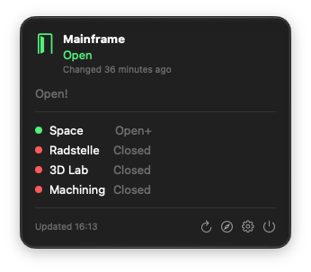
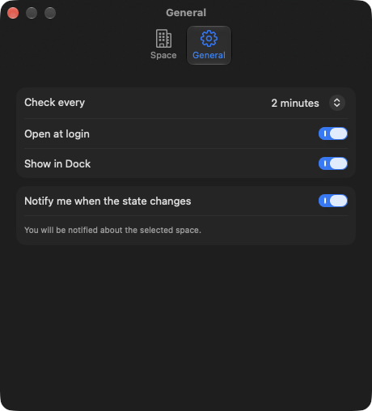
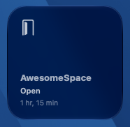
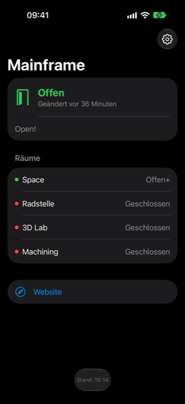

# SpaceState

Shows whether a hackerspace is open – in the macOS menu bar, on iOS and in widgets on both.

Any space listed in the [SpaceAPI directory](https://spaceapi.io) works. For [Mainframe Oldenburg](https://www.kreativitaet-trifft-technik.de) the app also shows its rooms (Radstelle, 3D Lab, Machining) and finer states such as "members only" or "closing".

Project status, decisions and next steps: [docs/PROJECT.md](docs/PROJECT.md).

## Features

### Everywhere

- Any space from the SpaceAPI directory, searchable by name and address; Mainframe Oldenburg is the default.
- Open, closed or unknown at a glance, with the time of the last change and the space's status message.
- Mainframe's rooms (Space, Radstelle, 3D Lab, Machining) with their own states.
- Push notifications when the selected space opens or closes, sent by [SpacePush](https://github.com/kerker00/SpacePush).
- State is read through SpacePush, with direct SpaceAPI requests as fallback.
- English and German.
- Usage statistics for SpacePush without an identifier: the apps send their version and OS version, and mark the first request of each day, week and month (`X-SpaceState-First`); SpacePush only adds these up. See [SpacePush's statistics](https://github.com/kerker00/SpacePush#statistics).

### macOS

- Menu bar item with the current state; a click opens a panel with details, rooms, the space's website, refresh and settings.
- Settings: space, check interval, open at login, Dock icon, notifications.
- Clicking a notification (or the Dock icon) opens the status in a regular window.
- Desktop and Notification Center widgets (small and medium).

### iOS

- Status screen with rooms, status message and a link to the space's website.
- Settings sheet with space search and notifications.
- Home screen widgets (small and medium) and lock screen widgets (circular, rectangular, inline).

Each widget chooses its own space, so several widgets can show different spaces.

## Screenshots

| macOS menu bar | macOS settings | macOS widget |
| --- | --- | --- |
|  |  |  |

| iOS (German) |
| --- |
|  |

## Requirements

For the Apple apps:

- macOS 26 / iOS 26
- Xcode 26 or later

The shared [SpaceStateKit package](https://github.com/kerker00/SpaceStateKit) requires Swift 6.2 or later. Xcode resolves the independently maintained package at the exact version `0.1.0`. The Kit repository owns its tests, Linux/macOS CI and releases.

## Structure

| Path | Contents |
| --- | --- |
| External `SpaceStateKit` dependency | Swift products `SpaceAPI`, `MainframeStatus` and `SpacePushClient`, pinned in the Xcode project |
| `Shared/` | App code shared by macOS and iOS |
| `macOS/` | Menu bar app |
| `iOS/` | iOS app |
| `Widget/` | WidgetKit extension for both platforms |
| `Config/` | Info.plist additions and entitlements |
| `docs/` | Project status and screenshots |

## Build

Open `SpaceState.xcodeproj` and run the `SpaceState-macOS` or `SpaceState-iOS` scheme.

The package sources are maintained separately. To run their tests in this workspace:

```sh
cd ../SpaceStateKit
swift test
python3 IntegrationTests/run.py
```

## Shared package and Linux CLI

[SpaceStateKit](https://github.com/kerker00/SpaceStateKit) contains the three shared products, their tests and fixtures. The original package history was preserved during extraction. Update the exact package version in Xcode deliberately when adopting a new release; do not reintroduce a source copy into this repository.

[SpaceStateCLI](https://github.com/kerker00/SpaceStateCLI) uses the same package for `search`, `status` and polling `watch`, with text, JSON, NDJSON and Waybar output. Linux/macOS verification and installation requirements are documented in those repositories.

A future Linux desktop interface and its notifications remain separate work. The Apple apps continue to own their SwiftUI interface, widgets and APNs device integration.

## License

MIT, see [LICENSE.MD](LICENSE.MD).
